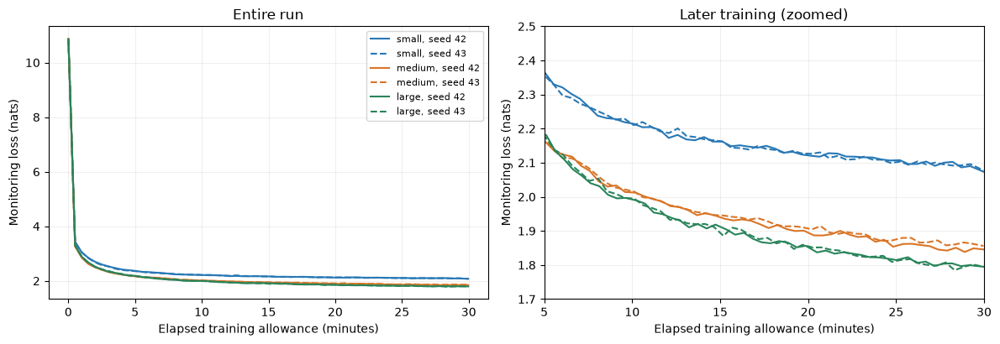
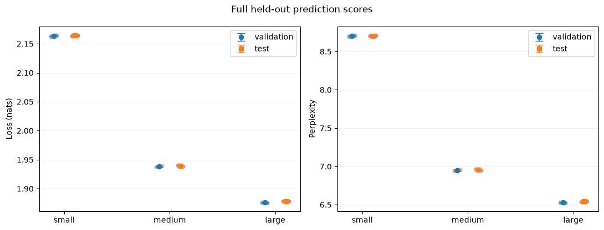
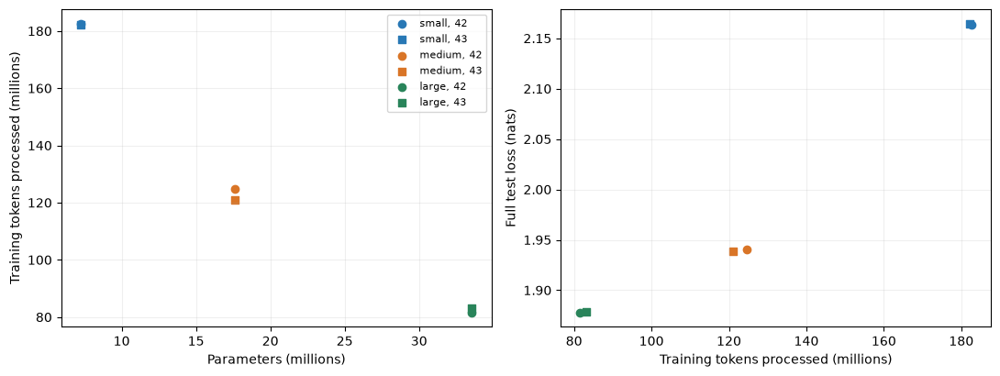

**Group Composition:**

1.  Hsu Yati Htet Naing, A0282862W, <e1156990@u.nus.edu>

2.  Tan Xin Yu, A0281824B, <e1155952@u.nus.edu>

**Github Repository:**
<https://github.com/txyxyz/dsa4212_assignment/tree/main>

# Introduction

Language models are usually compared at a fixed size or a fixed number
of training tokens. In practice, however, the real constraint is often
compute. A larger model has more capacity, but it also performs fewer
parameter updates in the same time and so sees fewer training tokens. A
smaller model sees more text but may plateau earlier. This project
studies that trade-off in a small, controlled setting.

**Research question.** Under the same 30-minute training allowance on a
single cloud GPU (Modal's A10 option), how does the size of a GPT-style
Transformer affect its prediction of held-out text from
TinyStories [@TS]?

We train three model sizes (about 7M, 18M and 34M parameters), each with
two random seeds, and compare them on held-out validation and test sets.
Our task is *next-token story continuation*: the models are not
instruction-tuned chatbots, and we make no claims about question
answering or reasoning.

**Declarations.**

- **Compute budget.** Each final run is limited to a wall-clock
  allowance of 30 minutes on Modal's A10 option, with a loop that stops
  near 1,798 seconds (Section [4.3](#sec:budget){reference-type="ref"
  reference="sec:budget"}). All final comparisons use this same
  allowance.

- **Initialisation.** Every model starts from randomly initialised
  weights, including the token and position embeddings. No pretrained
  weights or pretrained neural components are used. We reuse the GPT-2
  tokenisation rules and the Hugging Face GPT-2 implementation, which
  the assignment permits.

- **Evaluation objective.** Token-weighted cross-entropy (in nats) and
  the corresponding perplexity on held-out TinyStories text, computed on
  the full validation and test sets
  (Section [3](#sec:eval){reference-type="ref" reference="sec:eval"}).

# Background

## Next-token prediction and the GPT architecture

A decoder-only Transformer [@AV17] models a text as a sequence of tokens
$x_1,\dots,x_T$ and learns the conditional distribution of each token
given the ones before it: $$\begin{equation}
  p_\theta(x_1,\dots,x_T)=\prod_{t=1}^{T}p_\theta(x_t\mid x_{<t}).
\end{equation}$$ Each block contains masked multi-head self-attention
followed by a feed-forward network, with residual connections and layer
normalisation. The mask is a triangular matrix added to the attention
scores, $$\begin{equation}
  \text{Attention}(Q,K,V)=\text{Softmax}\!\left(\frac{QK^\top}{\sqrt{d_k}}+M\right)V,
\end{equation}$$ so that position $t$ cannot attend to later positions.
This is what lets the same network be trained on all positions of a
sequence in parallel and then used to generate text one token at a time.
GPT-2 [@GPT2] is a decoder-only model of this form, and we use its
Hugging Face implementation [@HF].

## Tokenisation

Text is converted to integer tokens with the GPT-2 byte-pair-encoding
tokeniser, whose vocabulary has 50,257 entries. We append one
end-of-story (EOS) token to each story. Because the vocabulary is large
relative to a small model's width, the embedding table accounts for a
large share of the parameters of the smallest model
(Section [4.1](#sec:models){reference-type="ref"
reference="sec:models"}).

## Compute allocation

Hoffmann et al. [@Chin] argue that, for a fixed compute budget, model
size and number of training tokens should be scaled together.
Muennighoff et al. [@Data] study the related case where the amount of
unique data is limited and examples are repeated. The practical
guides [@Kar; @Smol] describe how small models are trained efficiently.
Our setting is much smaller than these studies and uses a fixed
wall-clock time rather than a fixed number of FLOPs, so we use them only
as context and do not test their scaling laws.

# Data and Evaluation {#sec:eval}

## Dataset

TinyStories [@TS] is a collection of short, synthetic stories written in
simple vocabulary. We streamed 104,000 stories from the Hugging Face
dataset using a buffered shuffle (seed 42, buffer size 10,000), and
split them into 100,000 training, 2,000 validation and 2,000 test
stories. A buffered streaming shuffle is not a uniform sample of the
full corpus.

## Duplicate checking

We checked for exact story overlap between splits and found 55 unique
stories shared by training and validation, 77 by training and test, and
6 by validation and test. We kept the test set unchanged, removed test
stories from validation, and removed all held-out stories from training.
The final training set has 99,868 stories and the validation set has
1,994. After tokenisation, training contains 22,323,961 tokens and
validation contains 455,842 tokens. The exact test counts and hashes are
stored in the repository (`results/full-test/test_manifest.json`). Only
exact duplicates were removed; near-duplicates and repeated stories
inside a split may remain.

## Metrics

We report the average negative log-likelihood per token in natural-log
units (nats), $$\begin{equation}
  \mathcal{L}=-\frac{1}{N}\sum_{t=1}^{N}\ln p_\theta(x_t\mid x_{<t}),
\end{equation}$$ and the perplexity $\exp(\mathcal{L})$ of each run. For
a model size we report the arithmetic mean of the per-run perplexities,
which is not necessarily the same as $\exp$ of the mean loss.

Full evaluation runs on the CPU in float32, using 128-token windows with
stride 127, so that every next-token target is scored exactly once. The
context resets at every window, and EOS tokens count toward the loss.
Since all models share one tokeniser and the same tokenised text,
per-token loss is directly comparable across them, and we do not need a
bits-per-byte conversion. This would be required if tokenisers were
varied.

**What the metric leaves out.** Held-out loss measures how well a model
predicts the next token in this narrow, synthetic domain. It does not
measure story coherence, factual consistency, generalisation to other
text, or instruction following. We therefore also read generated samples
(Section [5.4](#sec:samples){reference-type="ref"
reference="sec:samples"}), but only as illustrations.

## Validation and test use

Validation data was used during the preliminary pilots and for
monitoring during training. The final protocol was fixed before the
final runs. The test set has been evaluated and seen, and we did not
tune any method against it.

# Models, Training and Budget

## Model sizes {#sec:models}

::: {#tab:models}
  Model      Layers   Width   Heads   Parameters
  -------- -------- ------- ------- ------------
  Small           4     128       4    7,242,624
  Medium          6     256       4   17,637,632
  Large           8     384       6   33,544,320

  : Model configurations. Parameter counts include the embeddings.
:::

Depth and width increase together, so this is a study of overall size
and not an isolated depth-versus-width comparison. With a vocabulary of
50,257 and width 128, the embedding table alone has about 6.4M entries,
so most of the small model's parameters sit in the embeddings. A larger
share of the medium and large models is spent in the Transformer blocks.

## Training recipe

All models share the same recipe: two seeds (42 and 43), context length
128, batch size 16 sequences, AdamW with a constant learning rate of
$3\times10^{-4}$, bfloat16 GPU training, gradient clipping at 1.0, and
the dropout setting stored in each saved configuration. The recipe was
fixed after 5- and 15-minute pilot runs of the small model. We did not
tune hyperparameters separately for each size, so a model size that
suits this recipe poorly would be penalised.

## Budget and what it counts {#sec:budget}

The budget is wall-clock time measured from *before* the initial
validation, so it includes periodic validation and checkpointing.
Startup and initialisation, and the final evaluation and saving, are
excluded from the allowance, although they are still billed by the cloud
provider. Each training loop stops near 1,798 seconds, leaving a small
safety margin. We therefore do not claim exactly 1,800 seconds of
optimiser updates, nor exactly 30 minutes of total billed GPU time. We
have not extracted the dollar cost from the billing records, and so do
not report one.

Monitoring validation runs about every 30 seconds on a fixed set of only
40 windows, and is used for the learning curves only. Checkpoints are
overwritten every five minutes and at the end, and the *final*
checkpoint (not the one with the lowest monitoring loss) is used for
every comparison.

## Hardware

All runs requested Modal's A10 option. Some devices reported themselves
as NVIDIA A10 and others as A10G. We record both labels and do not claim
perfectly identical hardware, so small differences in throughput may be
partly due to the device.

## Failed and retried runs

Final results use six completed runs. The first attempt at small seed 43
was cancelled at around 1,727 seconds, with its last checkpoint at 1,518
seconds. It was rerun from scratch with the same seed, and the completed
retry is used. The failed attempt is excluded from all averages and from
per-run allowances. The final large seed 43 run also carries a "retry"
label in its folder name; the reason for that retry is the run was
interrupted as our computer went into sleep mode. All preliminary pilots
are excluded.

# Results

## Learning curves

Figure [1](#fig:curves){reference-type="ref" reference="fig:curves"}
shows the monitoring loss against elapsed time for all six runs. All
models start near a loss of 11 nats and fall quickly in the first
minute. The curves for the same model size lie almost on top of each
other, while the three sizes separate clearly. The medium and large
models are close to each other early on, but the large model pulls ahead
after about 10 minutes. All curves are still decreasing at 30 minutes,
so none of the models has converged, and each would likely improve with
a longer allowance. Because the monitoring loss uses only 40 windows, it
is noisy and is not a substitute for the full evaluation.

<figure id="fig:curves" data-latex-placement="h">

<figcaption>Monitoring validation loss (40 fixed windows) against
elapsed training time for all six final runs. Solid lines are seed 42
and dashed lines are seed 43. The right panel zooms into later
training.</figcaption>
</figure>

## Full validation and test performance

::: {#tab:results}
  Model      Mean val. loss   Mean test loss $\pm$ SD   Mean test perplexity
  -------- ---------------- ------------------------- ----------------------
  Small            2.163921   2.164119 $\pm$ 0.000622               8.706929
  Medium           1.938332   1.939559 $\pm$ 0.001429               6.955688
  Large            1.876061   1.878328 $\pm$ 0.000637               6.542556

  : Full held-out results (nats). SD is the sample standard deviation
  across two training seeds only, and is not a confidence interval.
:::

Table [2](#tab:results){reference-type="ref" reference="tab:results"}
and Figure [2](#fig:heldout){reference-type="ref"
reference="fig:heldout"} show that held-out loss decreases with model
size, and that the validation and test results agree closely. The mean
test loss falls by about 0.225 nats from small to medium, but only by
about 0.061 nats from medium to large, even though the medium-to-large
step adds about 16M parameters. This is consistent with diminishing
returns from size under this allowance. The seed-to-seed standard
deviations (0.0006--0.0014) are much smaller than the gaps between model
sizes, so the ranking small $>$ medium $>$ large (in loss) is the same
for both seeds and both splits. With only two seeds, the standard
deviation itself is a rough estimate.

<figure id="fig:heldout" data-latex-placement="h">

<figcaption>Full validation and test loss (left) and perplexity (right)
for each model size. Dots are individual seeds, and bars show mean ± sample SD over the two seeds. Lower is
better.</figcaption>
</figure>

## Capacity versus throughput

All runs had the same time allowance, but larger models processed fewer
tokens. Reading from Figure [3](#fig:capacity){reference-type="ref"
reference="fig:capacity"}, the small model processed roughly 180M
tokens, the medium roughly 120M, and the large roughly 80M. These are
approximate values read from the plot, and the exact counts are in the
final row of each run's `metrics.jsonl`. The large model therefore saw
less than half the tokens of the small one, yet achieved the lowest
loss. Since the training set contains about 22.3M tokens, these token
counts correspond to several passes over the data, around 8 epochs for
the small model and about 4 for the large one, so repetition is part of
this setting. In this experiment, the benefit of extra capacity
outweighed the cost of fewer tokens.

<figure id="fig:capacity" data-latex-placement="h">

<figcaption>Left: training tokens processed against parameter count.
Right: full test loss against training tokens processed. Circles are
seed 42 and squares are seed 43.</figcaption>
</figure>

## Fixed-prompt story continuations {#sec:samples}

We generated continuations from all six final checkpoints for three
prompts, using identical decoding settings: temperature 0.8, top-$k$ 50,
at most 80 new tokens, and one fixed generation seed per prompt
(separate from the training seed). Outputs may end at an EOS token or
mid-sentence at the token limit. The prompts were chosen after the test
scores were known, so they illustrate behaviour and are not a new
unbiased benchmark. We kept all 18 outputs, including poor ones.
Table [3](#tab:samples){reference-type="ref" reference="tab:samples"}
shows the prompt *"Once upon a time, Mia found a small red key."*; the
full set is saved in `results/story-examples/samples.json`.

::: {#tab:samples}
  Model (seed)   Start of continuation
  -------------- -------------------------------------------------------------------------------------------------------------------------------------------
  Small (42)     "She was so excited as she opened it and saw a small puzzle. She put it in her pocket and turned it on."
  Medium (42)    "The key was very tight and she wanted to unlock it, so she tried to open the key. But she couldn't find it."
  Large (42)     "She was so excited as she looked through it. Mia could not wait to open it. Mia shouted out to her friend, John, 'Let's open the key!' "

  : Excerpts from the key prompt (seed 42 models, first sentences only).
:::

Reading all 18 samples, all models write grammatical, simple story prose
in the style of the training data. The small models more often drift:
for example, the key in the first prompt becomes a puzzle (small, seed
42), and in the third prompt a kite ends up being "so happy" (small,
seed 43). The medium and large models stay closer to the prompt for
longer and produce more dialogue, but they still show failures. For
instance, the large model (seed 42) writes "Let's open the key!", and in
the rain prompt the large model (seed 42) drifts into a storm that
"destroyed everything", which does not follow naturally from the prompt.
The medium model (seed 42) in the rain prompt introduces new characters,
Lily and Ben, and a dog that "showed its teeth", which also changes the
tone. Some outputs repeat phrases, such as "find his way back home" in
the medium model (seed 43). These are single samples at one temperature,
so they illustrate behaviour and do not prove that one model is more
coherent than another.

# Discussion

**Capacity versus throughput.** Under a 30-minute allowance, the largest
of the three models gave the best held-out loss despite processing the
fewest tokens. The training curves have not flattened by the end of the
run, which suggests that all three models are limited by training time
as much as by capacity. This supports a capacity benefit in this
experiment. It is not a universal scaling law, and it does not show that
larger is always better: a larger model could lose if the allowance were
much shorter, or if the data were smaller.

**Diminishing gains.** The gain from small to medium (about 0.225 nats)
is almost four times that from medium to large (about 0.061 nats). Part
of the small model's deficit may come from its embedding table taking
most of its parameters, leaving little capacity in the Transformer
blocks. We did not run an experiment that separates this effect.

**Seed variability.** Both seeds of each size gave very similar results,
and the ranking of sizes was identical. With only two seeds, however, we
cannot say how much larger the variance might be for other data subsets
or recipes.

**Relation to compute-optimal scaling.** We did not fit a scaling law,
as we have only three sizes at one budget. As a rough check, the small
model saw about 25 tokens per parameter (about 180M tokens for 7M
parameters), close to the rule of thumb of about 20 tokens per
parameter, whereas the large model saw only about 2.5 (about 80M tokens
for 34M parameters). Yet the large model was clearly better, so in this
setting the best of our three sizes lies well below that ratio. We do
not read this as contradicting the Chinchilla results [@Chin], which
concern different scales, data and compute accounting, and our largest
model may still be smaller than the true optimum or not yet well
trained. Whether a size even larger than 34M would do better under the
same allowance is untested.

**Open questions.** Would the ordering change at a longer allowance,
with a larger model still, or with a per-size learning rate? How much of
the small model's weakness is due to its embedding share? Does the
pattern hold with a smaller vocabulary?

# Limitations

- Only two seeds, one data subset, one context length (128) and one
  shared optimiser recipe were tested. The models were not individually
  tuned.

- Depth and width change together, so we cannot separate their effects.

- TinyStories is synthetic and narrow, which limits generalisation to
  other text. The subset comes from a buffered streaming shuffle, not a
  uniform sample.

- Only exact duplicates were removed. Near-duplicates and repetition
  within a split may remain, which could make the held-out scores
  optimistic.

- Hardware labels differed (A10 and A10G), and monitoring loss uses only
  40 windows.

- The budget excludes startup and final evaluation, so it is not the
  total billed GPU time, and we have not extracted the actual cost.

- The source revision and a full dependency lock were not saved at the
  start. Hashes allow artefacts to be checked, but do not by themselves
  guarantee reproduction from a fresh download. Checkpoints do not store
  random-number-generator state, and no resume code exists.

- The qualitative samples are few, use a single decoding setting, and
  were chosen after test scores were seen.

# Conclusion

Within a 30-minute allowance on an A10-class GPU, increasing a GPT model
from about 7M to 18M to 34M parameters lowered the held-out loss on
TinyStories from 2.164 to 1.940 to 1.878 nats (test perplexity 8.71,
6.96 and 6.54), even though the larger models processed fewer tokens.
The gains shrank at larger sizes, and the results were consistent across
two seeds and across validation and test. These findings are specific to
our short context, shared recipe and synthetic dataset, and we do not
claim a general scaling law. Natural extensions are to vary the
allowance, separate depth from width, tune each size individually, and
add more seeds.

**Use of AI assistance.** AI tools were used for troubleshooting and
drafting the write up.

::: thebibliography
99

Ashish Vaswani, Noam Shazeer, Niki Parmar, Jakob Uszkoreit, Llion Jones,
Aidan N. Gomez, Lukasz Kaiser, and Illia Polosukhin. Attention is all
you need. <https://arxiv.org/abs/1706.03762>, 2017.

Jordan Hoffmann, Sebastian Borgeaud, Arthur Mensch, et al. Training
compute-optimal large language models.
<https://arxiv.org/abs/2203.15556>, 2022.

Niklas Muennighoff, Alexander M. Rush, Boaz Barak, et al. Scaling
data-constrained language models. <https://arxiv.org/abs/2305.16264>,
2023.

Alec Radford, Jeffrey Wu, Rewon Child, David Luan, Dario Amodei, and
Ilya Sutskever. Language models are unsupervised multitask learners.
OpenAI technical report, 2019.

Hugging Face. Transformers library: GPT-2 model documentation.
<https://huggingface.co/docs/transformers/model_doc/gpt2>.

Andrej Karpathy. nanoGPT. <https://github.com/karpathy/nanoGPT>.

Hugging Face. The Smol Training Playbook.
<https://huggingface.co/spaces/HuggingFaceTB/smol-training-playbook>.

Ronen Eldan and Yuanzhi Li. TinyStories: How small can language models
be and still speak coherent English? <https://arxiv.org/abs/2305.07759>,
2023. Dataset: <https://huggingface.co/datasets/roneneldan/TinyStories>.
:::
